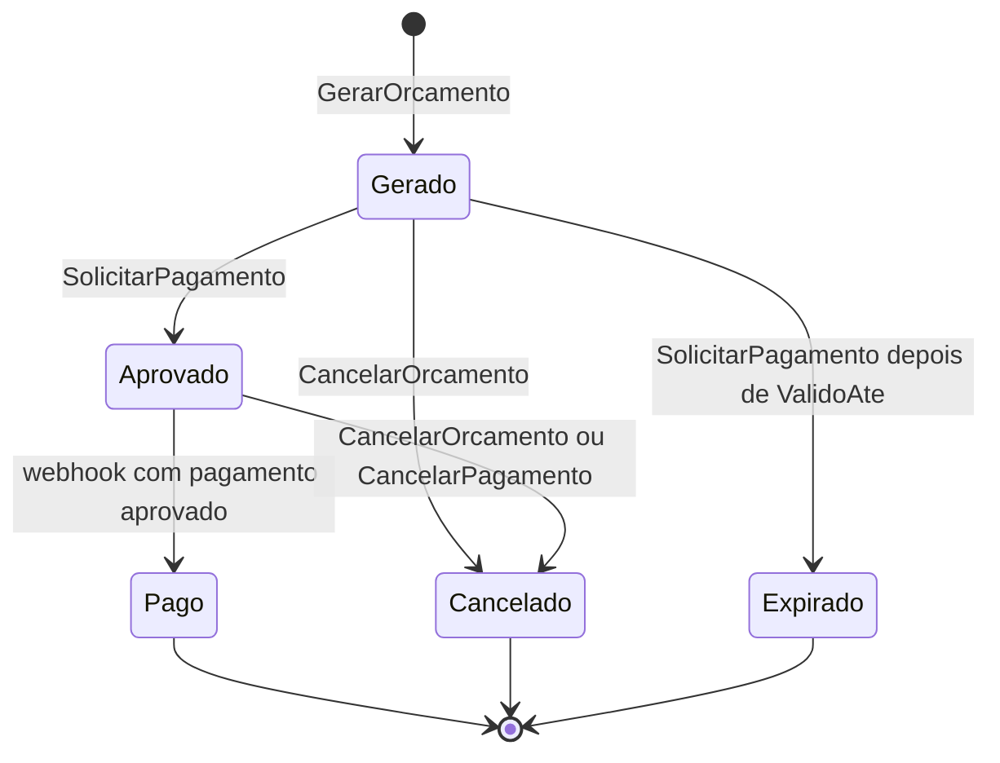
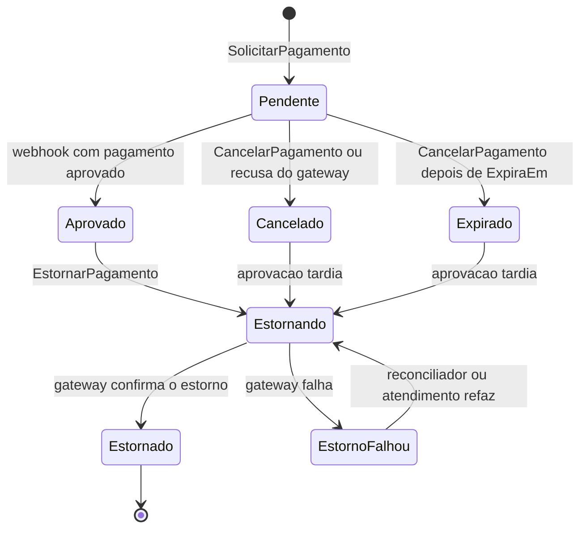
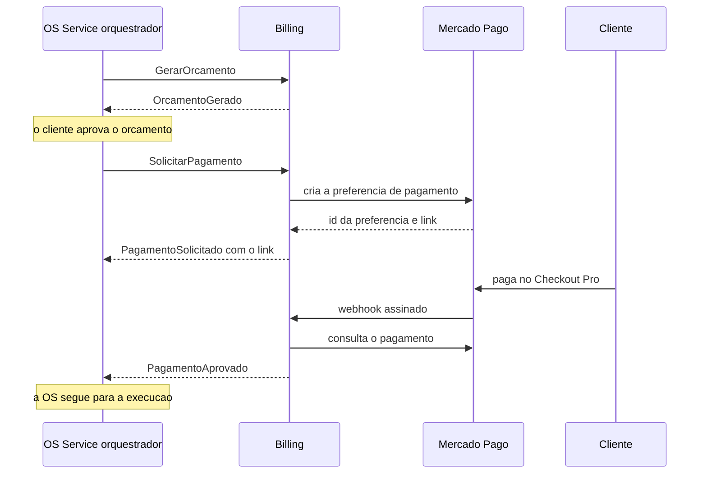

# OficinaMecanica.Billing

Servico de **orcamento e pagamento** do ecossistema OficinaMecanica (sistema de
ordens de servico de uma oficina mecanica). Ele gera e cancela o orcamento de
uma ordem de servico (OS), cobra o cliente pelo **Mercado Pago** (Checkout Pro),
confirma o pagamento por **webhook** assinado e devolve o dinheiro (estorno)
quando a Saga desfaz uma etapa. E um microsservico .NET 8 com banco proprio
(Azure SQL `BillingDb`), que conversa com os demais servicos por mensageria
(RabbitMQ, via MassTransit 8.5.12).

> **Estado de publicacao: nada foi publicado.** Este repositorio ainda nao existe
> no GitHub, o pipeline de CI/CD nunca rodou no GitHub Actions, nenhuma imagem foi
> enviada ao registry, nada foi implantado no cluster e a integracao real com o
> Mercado Pago nunca foi exercitada. Tudo o que esta descrito como "local" foi
> executado nesta maquina; tudo o que depende da publicacao esta marcado como
> **ainda nao executado** (resumo na secao 1 e roteiro completo na secao 11).

## Sumario

1. [Visao geral](#1-visao-geral)
2. [Arquitetura](#2-arquitetura)
3. [Integracao com o Mercado Pago](#3-integracao-com-o-mercado-pago)
4. [Papel na Saga: por que orquestrada e nao coreografada](#4-papel-na-saga-por-que-orquestrada-e-nao-coreografada)
5. [API e autenticacao](#5-api-e-autenticacao)
6. [Como rodar localmente](#6-como-rodar-localmente)
7. [Testes e qualidade](#7-testes-e-qualidade)
8. [CI/CD e Kubernetes](#8-cicd-e-kubernetes)
9. [Decisoes de arquitetura](#9-decisoes-de-arquitetura)
10. [Limitacoes conhecidas e pendencias](#10-limitacoes-conhecidas-e-pendencias)
11. [Publicacao (ainda nao executada)](#11-publicacao-ainda-nao-executada)

---

## 1. Visao geral

### O que o servico faz

- **Gera o orcamento** de uma OS quando a Saga pede (`GerarOrcamento`): guarda os
  itens de servico e de pecas como uma copia ("snapshot") dos valores daquele
  momento e responde com o evento `OrcamentoGerado`.
- **Cria o pagamento** do orcamento aprovado (`SolicitarPagamento`): registra um
  `Pagamento`, cria uma "preferencia" no Checkout Pro do Mercado Pago e devolve o
  link de pagamento no evento `PagamentoSolicitado`.
- **Confirma o pagamento**: o Mercado Pago avisa por webhook; o Billing valida a
  assinatura, consulta o pagamento no proprio Mercado Pago e so entao responde
  `PagamentoAprovado`.
- **Compensa**: cancela orcamento e pagamento (`CancelarOrcamento`,
  `CancelarPagamento`) e estorna pagamentos ja aprovados (`EstornarPagamento`),
  inclusive o pagamento aprovado depois de cancelado e a cobranca em duplicidade.
- **Expoe uma API REST** de consulta (orcamento e pagamento por OS, listagem
  paginada de orcamentos) e uma acao do atendimento para refazer um estorno que
  falhou.

O Billing e a **autoridade sobre o pagamento**: se a Saga pede para cancelar um
pagamento que o Mercado Pago ja aprovou, a resposta e `PagamentoAprovado`, nunca
um cancelamento que o dinheiro ja desmentiu.

### Onde se encaixa no ecossistema

O ecossistema e formado por tres servicos de negocio independentes (cada um com
repositorio, banco, pipeline e manifests proprios), mais o servico de
autenticacao, a infraestrutura e os bancos. Eles nao tem dependencia de
compilacao entre si: so se encontram em tempo de execucao (mensagens pelo
RabbitMQ e HTTP/JWKS para identidade). **O OS Service orquestra a Saga**, o
**Billing responde aos comandos** de orcamento e pagamento, e a **Execucao**
cuida da fila de diagnostico e reparo. O Billing nao tem contrato nem chamada para
a Execucao: quem fala com os dois e o orquestrador.

```
   Cliente / Atendimento
            |  HTTPS + JWT
            v
   +---------------------------+        webhook assinado         +---------------------+
   | APIM (Azure API           | <------------------------------ |                     |
   | Management)               |                                 |    Mercado Pago     |
   | rota /billingserver       |                                 |   (Checkout Pro)    |
   +-------------+-------------+                                 |                     |
                 | HTTP                                          |                     |
                 v                                               |                     |
   +---------------------------+  preferencia, consulta, estorno |                     |
   | OficinaMecanica.Billing   | ------------------------------> |                     |
   | (este repositorio)        |            (HTTPS)              +---------------------+
   | API, webhook, consumers,  |
   | outbox/inbox e            |
   | reconciliador             |
   +------+-------------+------+
          | SQL         | AMQP (MassTransit)
          v             v
   +-------------+   +-----------------------------------+
   | Azure SQL   |   | RabbitMQ (broker compartilhado)   |
   | BillingDb   |   +-----------+-----------------+-----+
   +-------------+               ^ comandos e      ^ comandos e
                                 | eventos         | eventos
                                 v                 v
                   +----------------------+  +-------------------------+
                   | OS Service           |  | Execucao                |
                   | orquestrador da Saga |  | diagnostico e reparo    |
                   | (OficinaMecanicaDb)  |  | (MongoDB Atlas)         |
                   +----------------------+  +-------------------------+

   OficinaMecanica.Seguranca: emite o JWT (RS256) e publica a chave publica (JWKS);
   o Billing so valida.
```

A rota `billingserver` da APIM e o RabbitMQ no cluster so existem depois que a
infraestrutura for aplicada (ver [secao 11](#11-publicacao-ainda-nao-executada)).
Localmente, o broker e o do `docker compose` do OS Service ou um broker proprio
deste repositorio (ver [secao 6](#6-como-rodar-localmente)).

### Repositorios do ecossistema

| Repositorio | Papel |
|-------------|-------|
| [OficinaMecanica](../OficinaMecanica) | **OS Service**: cadastros, ordens de servico, e-mail ao cliente e o orquestrador da Saga |
| **OficinaMecanica.Billing** (este) | Orcamento e pagamento (Mercado Pago) |
| [OficinaMecanica.Execucao](../OficinaMecanica.Execucao) | Fila de execucao, diagnostico e reparo (MongoDB Atlas) |
| [OficinaMecanica.Seguranca](../OficinaMecanica.Seguranca) | Autenticacao: emite JWT RS256 e expoe o JWKS |
| [OficinaMecanica.Infra](../OficinaMecanica.Infra) | Terraform da plataforma: AKS, ACR, Key Vault, APIM, RabbitMQ, identidades OIDC |
| [OficinaMecanica.Banco](../OficinaMecanica.Banco) | Terraform dos bancos: Azure SQL (um banco e um usuario por servico) e MongoDB Atlas |

Os links `../...` so funcionam com os repositorios clonados lado a lado na mesma
pasta; em um repositorio publicado isoladamente eles nao resolvem.

### Termos usados neste documento

| Termo | Significado |
|-------|-------------|
| OS | Ordem de servico |
| Saga | Sequencia de transacoes locais (uma por servico) em que cada etapa que muda estado tem uma **compensacao** que a desfaz; usada no lugar de uma transacao distribuida, que nao esta disponivel entre estes bancos independentes |
| Comando x evento | Comando e um pedido a um destinatario (`GerarOrcamento`); evento e um fato ja ocorrido, anunciado por quem o produziu (`OrcamentoGerado`) |
| Outbox / inbox | Tabelas no proprio banco que tornam atomicos "gravar o estado" e "enviar a mensagem" (outbox) e descartam mensagens repetidas na entrada (inbox) |
| Idempotencia | Repetir a mesma operacao produz o mesmo resultado, sem efeito duplicado |
| Gateway de pagamento | O provedor externo que cobra (aqui, o Mercado Pago), atras da interface `IPagamentoGateway` |
| Webhook | Chamada HTTP que o Mercado Pago faz ao Billing para avisar que um pagamento mudou |
| Estorno | Devolucao ao cliente do valor de um pagamento ja aprovado |
| Tombstone | Registro "lapide" (`CancelamentoPrevio`) de um cancelamento que chegou antes de o item existir |
| JWT / JWKS | JSON Web Token (a credencial enviada pelo cliente) / JSON Web Key Set (a chave publica que valida a assinatura do JWT) |
| APIM, AKS, ACR | Azure API Management (porta de entrada publica), Azure Kubernetes Service (cluster), Azure Container Registry (registry de imagens) |

### O que roda hoje e o que depende da publicacao

| Ja executado nesta maquina | Ainda nao executado (depende da publicacao) |
|----------------------------|---------------------------------------------|
| Build Release sem avisos e os 983 testes, incluindo os de infraestrutura com SQL Server e RabbitMQ reais em containers ([cobertura](docs/cobertura.md)) | Qualquer execucao do workflow `.github/workflows/ci.yml` no GitHub Actions |
| Stack local com `docker compose` (API, SQL Server, RabbitMQ opcional) e gateway de pagamento Fake | SonarCloud (analise e Quality Gate) |
| `bash scripts/ci-local.sh`: os mesmos passos do job `Build & Test` | Scan de vulnerabilidades da imagem (Trivy), push no ACR e deploy no AKS |
| Validacao estatica do workflow (`actionlint`), dos manifests (`kubeconform`) e `docker build` da imagem | Migration aplicada no `BillingDb` real e aplicacao dos manifests em um cluster |
| Scripts de CI testados com entradas sinteticas e mutantes (`scripts/testar-scripts.sh`) | Identidade OIDC do GitHub Actions, rota `billingserver` na APIM e RabbitMQ no cluster (todos criados pelo repositorio `OficinaMecanica.Infra`, que tambem nao foi aplicado) |
| Webhook assinado de ponta a ponta com o gateway Fake | Integracao real com o Mercado Pago (so testada com respostas simuladas no formato documentado) |
| | Ruleset de protecao de branch (`scripts/aplicar-ruleset.sh`) |

---

## 2. Arquitetura

### Camadas e projetos

Clean Architecture (as dependencias apontam para dentro: a `API` depende da
`Infrastructure`, que depende da `Application`, que depende do `Domain`), DDD
(Domain-Driven Design: as regras de negocio vivem nos agregados `Orcamento` e
`Pagamento`) e CQRS (Command Query Responsibility Segregation: escrita por
*commands*, leitura por *queries*, ambos via MediatR). Os mesmos padroes dos demais
repositorios do ecossistema.

| Projeto | O que faz |
|---------|-----------|
| `src/OficinaMecanica.Billing.Domain` | Entidades e regras: `Orcamento`, `Pagamento`, `TentativaPagamento`, `Estorno`, `WebhookRecebido`, `CancelamentoPrevio`; enums de estado; `DomainException`; interfaces de repositorio e de Unit of Work. Sem dependencias externas. Nunca le o relogio: recebe o "agora" por parametro |
| `src/OficinaMecanica.Billing.Application` | Commands e queries (MediatR) com seus handlers; validadores FluentValidation executados por um `ValidationBehavior` no pipeline; DTOs; as portas que a infraestrutura implementa (`IPagamentoGateway`, `IIntegrationEventPublisher`, `IAssinaturaWebhookValidator`, `IMetricasDoBilling`); a traducao entre contratos de mensagem e commands |
| `src/OficinaMecanica.Billing.Infrastructure` | EF Core (contexto, mapeamentos, migration, repositorios); MassTransit (consumers, publisher, outbox/inbox, bloqueio por OS); os dois gateways (Mercado Pago e Fake); validacao da assinatura do webhook; autenticacao JWT/JWKS; metricas; health checks; reconciliador de pagamentos |
| `src/OficinaMecanica.Billing.API` | ASP.NET Core: `Program.cs`, controllers, middleware de tratamento de erros, Swagger, `/health`, `/health/ready` e `/metrics` |
| `src/OficinaMecanica.Contracts` | **Copia** dos comandos e eventos que o Billing consome e publica (ver [Contratos de mensagem](#contratos-de-mensagem)) |

Cada handler segue a mesma ordem: valida a entrada, carrega o agregado, aplica a
regra de dominio, **publica a mensagem de resposta e so depois chama
`SaveChanges`**. A publicacao passa pela porta `IIntegrationEventPublisher`, que
grava no outbox dentro da mesma transacao do `SaveChanges`; publicar depois do
`SaveChanges` perderia a mensagem se o processo caisse entre as duas chamadas.

Falha de **negocio** vira evento explicito (`OrcamentoNaoGerado`,
`PagamentoNaoSolicitado`, `EstornoFalhou`), nunca excecao. Falha **tecnica**
(timeout, 5xx do gateway) propaga para o retry da mensagem.

### Banco de dados

- **Azure SQL `BillingDb`**, no servidor logico compartilhado `svsfiap`, com **um
  banco por servico**: nenhum servico le ou escreve o banco de outro.
- **Usuario SQL dedicado** (`app_billing`, `db_owner` apenas no `BillingDb`),
  nunca o administrador do servidor. A connection string fica no Key Vault
  (`billing-sql-connection-string`) e o usuario e criado pelo repositorio
  [OficinaMecanica.Banco](../OficinaMecanica.Banco).
- **EF Core 9.0.22** (alvo `net8.0`): o `MassTransit.EntityFrameworkCore` 8.5.12
  exige EF Core 9.
- Tabelas do dominio: `Orcamentos`, `ItensOrcamento`, `Pagamentos`,
  `TentativasPagamento`, `Estornos`, `WebhooksRecebidos` e `CancelamentosPrevios`,
  mais as tabelas de inbox e outbox do MassTransit. A migration `Inicial` cria tudo.
- Dinheiro em `decimal(18,2)`, sempre maior que zero, com teto de R$ 1.000.000,00
  por preco unitario, valor total e pagamento (quantidade ate 10.000); valor
  invalido vira `OrcamentoNaoGerado`, nunca excecao nao tratada.
- Concorrencia otimista (coluna `Version`) e **indices unicos que sustentam a
  idempotencia**: por OS em `Orcamentos` e em `Pagamentos`, por id do pagamento no
  gateway em `TentativasPagamento`, por `RequestId` em `WebhooksRecebidos`, por
  (OS, tipo) em `CancelamentosPrevios` e por pagamento em `Estornos`.
- **Migrations**: em `Development` a API migra sozinha na partida; em `Production`
  nunca. No pipeline, o job de deploy roda `dotnet ef database update` antes do
  rollout ([ADR 0003](docs/adr/0003-ci-cd-independente-com-gate-de-qualidade.md)).

### Mensageria

- **RabbitMQ** (protocolo AMQP) acessado pelo **MassTransit 8.5.12**. A versao e
  **exata e fixa** em todos os pacotes `MassTransit*`: a linha 9.x do MassTransit
  exige licenca comercial; a 8.x e gratuita (Apache 2.0), mas sem suporte oficial
  depois de 31/12/2026 (ver [Limitacoes](#10-limitacoes-conhecidas-e-pendencias)).
  Tres travas impedem a troca acidental: versoes sem curinga nos `.csproj`; o
  script `scripts/verificar-masstransit.sh`, que reprova o CI se qualquer pacote
  `MassTransit*`, direto ou transitivo, resolver para outro major; e o Dependabot
  configurado para ignorar atualizacoes de major. Como o Domain e a Application
  so conhecem a porta `IIntegrationEventPublisher`, trocar de biblioteca no futuro
  mexe so na Infrastructure.
- **Uma fila de entrada**: `billing-comandos` (constante `Filas.Billing` nos
  contratos). Os eventos de resposta sao publicados (`Publish`) e o orquestrador
  os recebe pela fila dele (`os-saga`). Mensagem que esgota o retry vai para a
  fila `_error` do endpoint.
- **Outbox transacional**: a mensagem e gravada no banco na mesma transacao do
  estado e so e entregue ao RabbitMQ depois do commit. Commit entrega, rollback
  descarta; se o broker estiver fora, as mensagens esperam no banco. Isso vale
  tambem para o caminho HTTP (webhook, estorno do atendimento, reconciliador).
- **Inbox**: o broker entrega "pelo menos uma vez", entao a mesma mensagem pode
  chegar repetida. O `MessageId` do contrato e **deterministico** (derivado do
  agregado e do tipo da mensagem) e e copiado para o envelope; o inbox descarta a
  repeticao e, mesmo sem ele, os handlers sao idempotentes por estado.
- **Retry**: tentativas apos 500 ms, 2 s, 10 s, 30 s e 60 s, reprocessando a
  mensagem inteira em transacao nova. Nao repete o que nao muda de resultado
  (validacao invalida, regra de negocio violada, assinatura invalida); repete as
  falhas tecnicas, inclusive o gateway indisponivel.
- **Exclusividade por OS**: todo consumer pede um bloqueio de banco
  (`sp_getapplock`, ate 20 s) da OS antes de executar. Sem ele, `GerarOrcamento`
  e `CancelarOrcamento` da mesma OS processados ao mesmo tempo nao se enxergariam
  e o cancelamento se perderia.
- **Troca para teste**: `Mensageria:Transporte` (`RabbitMq` | `EmMemoria`) e
  `Mensageria:Persistencia` (`EntityFramework` | `Nenhuma`) existem so para os
  testes. Fora de `Development` e `Testing` a API **recusa subir** com os valores
  de atalho, porque sem broker e sem outbox ela ficaria "saudavel" e perderia
  mensagens em silencio.

### Contratos de mensagem

`OficinaMecanica.Contracts` e uma **copia** do subconjunto de contratos usado pelo
Billing; a mudanca de um contrato nasce no OS Service e e recopiada (evolucao
somente aditiva). O MassTransit identifica a mensagem por namespace e nome, entao
produtor e consumidor precisam concordar nos dois. A compatibilidade e travada por
**testes de contrato com arquivos golden JSON** cujos bytes sao identicos aos do
OS Service ([ADR 0005 do OS Service](../OficinaMecanica/docs/adr/0005-contratos-de-mensagem-por-copia-com-golden-json.md)).
Toda mensagem leva `MessageId`, `OrdemDeServicoId` e `OcorridoEm`, e nenhuma leva
dado pessoal.

**Comandos consumidos** (fila `billing-comandos`):

| Comando | Efeito no Billing | Resposta |
|---------|-------------------|----------|
| `GerarOrcamento` | Cria o `Orcamento` (`Gerado`) com os itens em snapshot. Se ja existe, republica a mesma resposta. Se havia um cancelamento previo, ou os dados violam uma regra de dominio, nao cria nada | `OrcamentoGerado`, ou `OrcamentoNaoGerado` com o motivo |
| `SolicitarPagamento` | Aprova o orcamento (`Gerado` -> `Aprovado`), grava um `Pagamento` `Pendente` e cria a preferencia no gateway. Se o orcamento nao existe, expirou, houve cancelamento previo ou o gateway recusou, nao cobra. Se o pagamento ja existe, republica o estado atual | `PagamentoSolicitado` (link e prazo), ou `PagamentoNaoSolicitado`; para um pagamento ja aprovado, `PagamentoAprovado` |
| `CancelarOrcamento` | Marca o orcamento `Cancelado` (no-op se ja `Cancelado`/`Expirado`; um orcamento `Pago` nao pode ser cancelado). Se o orcamento ainda nao existe, grava o tombstone. `OrcamentoId` e opcional: localiza pela OS | Nenhuma (compensacao silenciosa) |
| `CancelarPagamento` | `Pendente` -> `Cancelado` (ou `Expirado`, se ja passou de `ExpiraEm`) e cancela o orcamento se ele esta `Aprovado`. Se o Mercado Pago ja aprovou, nada e cancelado. Sem pagamento, grava o tombstone. `PagamentoId` e opcional | `PagamentoCancelado` (com `PagamentoId` nulo se nao havia pagamento), ou `PagamentoAprovado` se ja estava pago |
| `EstornarPagamento` | Pede o estorno total ao gateway com chave de idempotencia `refund-{PagamentoId}`. Pagamento ja estornado: republica. Pagamento inexistente ou que nao pode ser estornado: nao deixa a Saga sem resposta | `PagamentoEstornado`, ou `EstornoFalhou` com texto fixo (nunca o texto do gateway) |

O Billing tambem **envia `EstornarPagamento` para a propria fila** quando um
pagamento e aprovado depois de cancelado ou expirado, e o reconciliador o reenvia
enquanto um estorno estiver pendente.

**Eventos publicados** e o que a Saga faz com cada um (conforme o
[diagrama de estados da Saga](../OficinaMecanica/docs/saga-maquina-de-estados.puml)):

| Evento | Quando o Billing o publica | Efeito na Saga |
|--------|----------------------------|----------------|
| `OrcamentoGerado` | Orcamento criado (ou comando repetido) | OS passa a `AguardandoAprovacao`, com o prazo de aprovacao |
| `OrcamentoNaoGerado` | Dados invalidos ou cancelamento previo | OS `Cancelada` |
| `PagamentoSolicitado` | Preferencia criada no gateway | Grava `PagamentoId` e o link de pagamento da OS |
| `PagamentoNaoSolicitado` | Orcamento ausente/expirado, cancelamento previo ou gateway recusou | OS `Cancelada` (libera o estoque e envia `CancelarOrcamento`) |
| `PagamentoAprovado` | Webhook confirmado; ou resposta a `CancelarPagamento`/`SolicitarPagamento` para um pagamento ja aprovado | OS `EmExecucao` (envia `IniciarExecucao`); se chegou durante o cancelamento por prazo, segue como pago; se o staff cancelou, a Saga estorna |
| `PagamentoCancelado` | Pagamento cancelado (ou inexistente) | OS `Cancelada` (libera o estoque) |
| `PagamentoEstornado` | Gateway confirmou o estorno | `Estornando` -> `Cancelada` (libera o estoque); tambem tira a OS de `EstornoPendenteManual` |
| `EstornoFalhou` | Gateway recusou/falhou, ou o pagamento nao e estornavel | `Estornando` -> `EstornoPendenteManual` (alerta; so sai com `PagamentoEstornado`) |

`PagamentoEstornado` e `EstornoFalhou` tambem saem do estorno automatico por
pagamento tardio, do reconciliador e da acao do atendimento, situacoes em que a
Saga pode nao estar em `Estornando`; o diagrama da Saga declara que esses eventos
sao ignorados fora desse estado.

### Ciclo de vida do Orcamento



| Estado | Como se chega | Observacoes |
|--------|---------------|-------------|
| `Gerado` | `GerarOrcamento` valido | Valor total igual a soma dos subtotais dos itens, ao menos um item, validade no futuro; no maximo um orcamento por OS |
| `Aprovado` | `SolicitarPagamento` | O orcamento e aprovado no mesmo passo em que o pagamento nasce |
| `Pago` | Webhook com pagamento aprovado | Final; nao pode mais ser cancelado |
| `Cancelado` | `CancelarOrcamento`; ou `CancelarPagamento` sobre um orcamento `Aprovado` | Guarda o motivo; cancelar de novo e no-op |
| `Expirado` | `SolicitarPagamento` chegou com o orcamento `Gerado` ja vencido | Responde `PagamentoNaoSolicitado` |

### Ciclo de vida do Pagamento



| Estado | Como se chega | Observacoes |
|--------|---------------|-------------|
| `Pendente` | `SolicitarPagamento` | Gravado **antes** de chamar o gateway; depois de criar a preferencia guarda `PreferenceId` e `LinkPagamento`. Aceita varias tentativas de pagamento no mesmo link |
| `Aprovado` | Webhook confirmado (valor, moeda e referencia conferem) | Guarda o id do pagamento no gateway e a data |
| `Cancelado` | `CancelarPagamento` sobre `Pendente`; ou recusa permanente do gateway ao criar a preferencia | Guarda o motivo |
| `Expirado` | `CancelarPagamento` depois de `ExpiraEm` | A causa real fica no historico |
| `Estornando` | `EstornarPagamento`, a partir de `Aprovado` ou de um pagamento tardio | O `Estorno` conta as tentativas |
| `Estornado` | Gateway confirma | Final; guarda o id do estorno |
| `EstornoFalhou` | Gateway falhou ou recusou | Pode ser refeito pelo reconciliador ou por `POST /api/pagamentos/{id}/estornar` |

Uma tentativa recusada pelo Mercado Pago (`rejected`) **nao e falha final**: so e
registrada em `TentativaPagamento`, e o mesmo link continua aceitando novas
tentativas ate o prazo. Uma tentativa `approved` nunca e rebaixada.

### Idempotencia e compensacoes

| Situacao | Como o Billing se comporta |
|----------|----------------------------|
| **Comando repetido** (reentrega do broker) | O inbox descarta pelo `MessageId` deterministico; se passar, o handler ve que ja esta no estado alvo e republica a mesma resposta |
| **Cancelar antes de criar** | Se `CancelarOrcamento`/`CancelarPagamento` chega antes de `GerarOrcamento`/`SolicitarPagamento`, o Billing grava um **tombstone** (`CancelamentoPrevio`, por OS e tipo) e responde. O comando de criacao que chegar depois nao cria nada e responde `OrcamentoNaoGerado`/`PagamentoNaoSolicitado`. Por isso `OrcamentoId` e `PagamentoId` sao opcionais nesses comandos. Ids vazios sao tratados como ausentes (nunca viram erro de validacao, que deixaria a Saga sem resposta) |
| **Cancelamentos concorrentes** | O bloqueio por OS serializa as mensagens da mesma OS, mesmo com varias replicas |
| **Pagamento tardio** (aprovado depois de `Cancelado`/`Expirado`) | Registra `AprovacaoTardia` e envia `EstornarPagamento` para a propria fila, no mesmo `SaveChanges` (outbox). A reentrega do webhook reenvia o comando enquanto o estorno nao terminar |
| **Cobranca em duplicidade** (um segundo pagamento aprovado para o mesmo `Pagamento`) | Registra a tentativa, emite aviso e metrica (`aprovacoes_duplicadas_total`); o reconciliador estorna a cobranca extra com a chave `refund-duplicidade-{payment.id}` |
| **Estorno idempotente** | A chave de idempotencia `refund-{PagamentoId}` faz o gateway devolver o mesmo estorno se o pedido for repetido: nunca devolve duas vezes |
| **Reconciliador** (`BackgroundService`) | A cada 300 s (configuravel) lista ate 50 pagamentos cujo dinheiro ainda precisa voltar e reenvia o comando de estorno. Ao atingir 10 tentativas, marca o estorno como **abandonado** (um unico log de erro e a metrica `estornos_abandonados_total`) e o caso fica para o atendimento, que usa `POST /api/pagamentos/{id}/estornar`. E seguro com varias replicas |
| **Estorno impossivel** | Pagamento inexistente ou nao estornavel responde `EstornoFalhou`, nunca deixa a Saga esperando em `Estornando` |
| **Webhook repetido** | Deduplicado por `WebhookRecebido.RequestId` e, em outra camada, pelo id do pagamento no gateway (ambos com indice unico) |
| **Preferencia orfa** | Se o processo cair entre criar o pagamento e gravar o link, a preferencia sem link gravado nao cobra ninguem; a reentrega retoma o `Pagamento` `Pendente` sem criar um segundo |
| **Texto do gateway** | Nenhum texto devolvido pelo Mercado Pago e gravado ou publicado: `Estorno.Erro` e `EstornoFalhou.Erro` usam frases fixas; a excecao completa vai so para o log |

### Stack

| Categoria | Tecnologia | Versao |
|-----------|------------|--------|
| Runtime | .NET / ASP.NET Core | 8.0 |
| ORM | Entity Framework Core (SQL Server) | 9.0.22 |
| Mensageria | MassTransit + RabbitMQ, outbox/inbox EF | 8.5.12 (fixa) |
| CQRS e validacao | MediatR / FluentValidation | 12.2.0 / 11.9.0 |
| Pagamento | SDK `mercadopago-sdk` | 3.7.1 |
| Autenticacao | JwtBearer + Microsoft.IdentityModel (JWKS) | 8.0.0 / 7.7.1 |
| Observabilidade | Serilog, OpenTelemetry (OTLP), prometheus-net | 8.0.0 / 1.16.0 / 8.2.1 |
| API Docs | Swashbuckle (Swagger UI) | 6.5.0 |
| Testes | xUnit, FluentAssertions, Moq, Bogus, Testcontainers (SQL Server e RabbitMQ) | 2.4.2 / 6.12.0 / 4.20.70 / 35.6.1 / 4.1.0 |

---

## 3. Integracao com o Mercado Pago

O servico usa o **Checkout Pro**: o cliente paga em uma pagina hospedada pelo
proprio Mercado Pago, entao **nenhum dado de cartao passa pelo Billing**. A
escolha esta no [ADR 0001](docs/adr/0001-mercado-pago-checkout-pro-com-gateway-abstrato.md).

### `IPagamentoGateway`: real em producao, Fake em desenvolvimento

A Application conhece so a interface `IPagamentoGateway` (criar preferencia,
obter pagamento, estornar). A Infrastructure tem duas implementacoes, escolhidas
por `Pagamento:Provider`:

| Provedor | Onde vale | Comportamento |
|----------|-----------|---------------|
| `MercadoPago` (padrao) | Qualquer ambiente, obrigatorio fora de `Development` | `MercadoPagoGateway`, sobre o SDK `mercadopago-sdk` |
| `Fake` | **So em `Development`** (a partida falha em qualquer outro ambiente) | `FakePagamentoGateway`: em memoria, deterministico, com estado manipulavel; o fluxo inteiro, inclusive o webhook assinado, roda sem credencial |

O padrao e `MercadoPago` de proposito: esquecer a configuracao em um ambiente real
derruba a partida (o provedor real exige `AccessToken`, `WebhookSecret` e
`NotificationBaseUrl`) em vez de subir com um gateway de mentira. As credenciais
vem so de variavel de ambiente ou Key Vault, nunca do repositorio.

### Preferencia de pagamento

- Um item unico com o valor do pagamento e um titulo com o numero da OS.
- `external_reference` = id do `Pagamento` (e como o webhook localiza o pagamento).
- `notification_url` = `{NotificationBaseUrl}/webhooks/mercadopago`.
- Expiracao no prazo de pagamento definido pela Saga; **boleto excluido** (compensa
  em dias, fora do prazo).
- URLs de retorno do cliente (`back_urls`) sao opcionais; `auto_return=approved` so
  e enviado se houver a URL de sucesso.
- Chave de idempotencia da criacao: `preference-{PagamentoId}`.
- `HttpClient` com timeout curto (`MercadoPago:TimeoutSegundos`, padrao 10 s) e o
  retry interno do SDK desligado: a chamada roda com a transacao do consumer
  aberta, e quem repete e o retry da mensagem.

### Webhook assinado

`POST /webhooks/mercadopago` e uma rota anonima: quem autentica a chamada e a
assinatura do cabecalho `x-signature` (formato `ts=...,v1=...`). O validador
(`AssinaturaWebhookMercadoPago`) confere:

1. o cabecalho existe e traz `ts` e `v1`;
2. `ts` e numerico (segundos ou milissegundos) e esta dentro da **tolerancia** de
   tempo (300 s, configuravel em `MercadoPago:ToleranciaDaAssinaturaSegundos`), o
   que barra a repeticao de uma notificacao antiga;
3. `v1` e o **HMAC-SHA256** (hash com chave secreta) do *manifest*
   `id:<data.id em minusculas>;request-id:<x-request-id>;ts:<ts>;` calculado com
   o segredo do webhook (`MercadoPago:WebhookSecret`). O `;` final faz parte do
   manifest e um campo ausente simplesmente sai dele;
4. a comparacao e feita em **tempo constante**, para nao vazar informacao pelo
   tempo de resposta.

Assinatura ausente, invalida ou fora da tolerancia responde **401 sem dizer qual
parte falhou**. O `data.id` e lido da query string (o valor que o Mercado Pago
assina) e, na falta dela, do corpo. So o topico `payment` e processado; os demais
recebem 200 e sao ignorados.

### Sempre consultar o pagamento antes de agir

Depois da assinatura, o corpo do webhook **nunca e confiavel**. O handler:

1. descarta entregas repetidas (`WebhookRecebido.RequestId` ja processado);
2. **consulta o pagamento no Mercado Pago** pelo id notificado;
3. localiza o `Pagamento` local pelo `external_reference` e **confere valor,
   moeda (BRL) e referencia**. Divergencia nao aprova nada: responde 200, mas deixa
   um log de erro com os valores e incrementa `divergencias_de_pagamento_total`;
4. se o Mercado Pago ainda nao conhece o pagamento (404 logo depois de notificar),
   responde **503 com `Retry-After`** para o Mercado Pago reentregar; responder 200
   faria ele nunca mais tentar. So se ignora (200) quando o pagamento do gateway
   existe mas nao tem `Pagamento` local.

### Estorno com chave de idempotencia

O estorno e total (sem valor no pedido) e envia o cabecalho `X-Idempotency-Key`
(`refund-{PagamentoId}`; para cobranca em duplicidade,
`refund-duplicidade-{payment.id}`): repetir o pedido devolve o mesmo estorno. O
Billing grava o estado `Estornando` **antes** de chamar o gateway.

### Classificacao dos erros do gateway

| Resposta | Tratamento |
|----------|------------|
| 4xx definitivo (400, 404, 410, 422...) | Recusa de negocio (`PagamentoRecusadoPeloGatewayException`): a Saga recebe `PagamentoNaoSolicitado` ou `EstornoFalhou`. Na criacao da preferencia, tambem vira log de erro e metrica `pagamentos_recusados_pelo_gateway_total` (pode ser defeito do proprio request) |
| 401, 403 (credencial), 408, 409, 423, 425, 429 e todo 5xx | **Falha tecnica**: o retry da mensagem repete e a falha e alertada. Transformar um token errado em "pagamento recusado" cancelaria a ordem do cliente por um erro de configuracao nosso |
| 404 ao consultar um pagamento | "Ainda nao existe": ver acima (503 para o webhook) |

A integracao real so sera verificada no primeiro deploy com credenciais de teste
(sandbox) do Mercado Pago: os testes do adaptador usam um `HttpMessageHandler` falso
com respostas no formato documentado.

---

## 4. Papel na Saga: por que orquestrada e nao coreografada

Abrir uma OS, gerar o orcamento, esperar a aprovacao, cobrar e executar cruza tres
servicos com bancos independentes. Nao existe transacao distribuida (RFC 0005:
nem o Azure SQL serverless nem o MongoDB Atlas oferecem 2PC/MSDTC), entao a
consistencia vem de uma **Saga**. Ha dois estilos:

- **Orquestrada**: um coordenador central comanda cada etapa e reage as respostas.
- **Coreografada**: cada servico reage a eventos dos outros, sem coordenador.

O ecossistema adotou a **Saga orquestrada, com o orquestrador no OS Service**
(dono do agregado `OrdemDeServico`), implementada como uma maquina de estados do
MassTransit persistida no banco do OS Service junto com o outbox. Resumo do
[ADR 0003 do OS Service](../OficinaMecanica/docs/adr/0003-saga-orquestrada-no-os-service.md)
e do [RFC 0005](../OficinaMecanica/docs/rfc/0005-decomposicao-em-microsservicos-com-saga-orquestrada.md):

- **Por que orquestrada**: o fluxo e **linear, com compensacoes bem definidas**.
  Em uma coreografia ele ficaria espalhado em tres repositorios, a compensacao seria
  dificil de rastrear e de testar de ponta a ponta, e acrescentar uma etapa exigiria
  mexer em varios servicos. Com o orquestrador, o fluxo inteiro fica em um unico
  lugar (**rastreabilidade**: o estado da Saga mostra exatamente onde cada OS parou)
  e pode ser **testado** com cenarios BDD sem subir os tres servicos.
- **Custo aceito**: o OS Service concentra o conhecimento do processo (acoplamento
  de orquestracao) e vira um ponto sensivel de disponibilidade para o fluxo. O
  outbox mitiga: nada se perde, so atrasa. Tambem ha mais mensagens e mais estados
  do que em uma coreografia minima, o que exige disciplina de idempotencia em
  todo comando e consumer (o que este servico faz, ver secao 2).
- **Alternativa descartada**: um orquestrador como servico separado criaria um
  quarto servico para operar, sem ganho, ja que o OS Service e dono do agregado que
  a Saga conduz.

### O Billing e proposital simples

O Billing **nao conhece o fluxo completo**: recebe um comando, executa uma
transacao local e responde com um evento. Ele nao sabe quem o chamou, qual e o
proximo passo nem o que a Saga fara com a resposta. A orquestracao (prazos de
aprovacao e de pagamento, reserva e liberacao de estoque, decisao de estornar)
fica toda no OS Service. A divisao de responsabilidades e esta:

| Etapa da Saga | Comando que o OS Service envia | Resposta do Billing |
|---------------|--------------------------------|---------------------|
| Diagnostico concluido, gerar o orcamento | `GerarOrcamento` | `OrcamentoGerado` / `OrcamentoNaoGerado` |
| Cliente aprovou o orcamento | `SolicitarPagamento` | `PagamentoSolicitado` / `PagamentoNaoSolicitado` |
| Cliente pagou (webhook do Mercado Pago) | (nenhum: o Billing age sozinho) | `PagamentoAprovado` |
| Orcamento recusado ou expirado | `CancelarOrcamento` | (nenhuma) |
| Prazo de pagamento vencido, ou cancelamento pelo atendimento | `CancelarPagamento` | `PagamentoCancelado` ou, se ja pago, `PagamentoAprovado` |
| Execucao inviavel apos o pagamento, ou cancelamento de um pagamento ja aprovado | `EstornarPagamento` | `PagamentoEstornado` / `EstornoFalhou` |



A maquina de estados completa, com todas as compensacoes, esta em
[`saga-maquina-de-estados.puml`](../OficinaMecanica/docs/saga-maquina-de-estados.puml)
(repositorio do OS Service). Pontos do contrato entre os servicos:

- Um estorno que falha leva a Saga a `EstornoPendenteManual`: ela so cancela a OS
  quando o atendimento refaz o estorno (`POST /api/pagamentos/{id}/estornar`) e o
  Billing publica `PagamentoEstornado`.
- O Billing **nao cancela o orcamento em cascata** quando responde
  `PagamentoNaoSolicitado`: a Saga envia `CancelarOrcamento`.
- A Saga deve tratar como idempotentes `OrcamentoGerado`/`PagamentoSolicitado`
  repetidos com o mesmo `MessageId`, e aceitar `PagamentoCancelado` com
  `PagamentoId` nulo.

---

## 5. API e autenticacao

Contrato completo em [`docs/openapi.json`](docs/openapi.json) (OpenAPI gerado a
partir da API compilada; o CI reprova o PR se o arquivo estiver desatualizado).

| Metodo e rota | Controller | Acesso | O que faz |
|---------------|------------|--------|-----------|
| `GET /api/orcamentos/ordem-de-servico/{ordemDeServicoId}` | `OrcamentosController` | JWT valido | Orcamento da OS, com os itens (200) ou 404 se ainda nao existe |
| `GET /api/orcamentos?pagina=1&tamanhoPagina=10&status=` | `OrcamentosController` | JWT valido | Lista paginada, do mais recente para o mais antigo; `tamanhoPagina` de 1 a 100; filtro opcional por status |
| `GET /api/pagamentos/ordem-de-servico/{ordemDeServicoId}` | `PagamentosController` | JWT valido | Pagamento da OS, com as tentativas registradas no gateway e o estorno (200) ou 404 |
| `POST /api/pagamentos/{id}/estornar` | `PagamentosController` | JWT valido | Refaz o estorno de um pagamento em `EstornoFalhou` (corpo opcional com o `motivo`, ate 500 caracteres); 400 se o pagamento nao esta com estorno falho |
| `POST /webhooks/mercadopago` | `WebhooksController` | **Anonima**, autenticada pela assinatura `x-signature` | Notificacao do Mercado Pago (ver [secao 3](#3-integracao-com-o-mercado-pago)) |
| `POST /dev/pagamentos/{preferenceId}/aprovar` e `.../recusar` | `DevPagamentosController` | Anonima; **so existe com `Pagamento:Provider=Fake` em `Development`** (em outro caso a rota nem e registrada e nao aparece no Swagger) | Simula o cliente pagando ou o cartao sendo recusado e dispara o webhook com assinatura valida |
| `GET /health`, `GET /health/ready`, `GET /metrics` | (infraestrutura) | Anonimas | Liveness, prontidao e metricas Prometheus (ver [secao 6](#6-como-rodar-localmente)) |
| `GET /` (Swagger UI) e `GET /swagger/v1/swagger.json` | (infraestrutura) | Anonimas | Documentacao interativa |

**Nenhuma rota exige papel (*role*)**: todas as autenticadas aceitam qualquer JWT
valido emitido pelo Seguranca, inclusive a acao de estorno, que e descrita como do
atendimento (ver [Limitacoes](#10-limitacoes-conhecidas-e-pendencias)).

Erros saem em JSON (`tipo`, `mensagem` e, na validacao, `erros` por campo):
regra de dominio ou validacao = 400, nao encontrado = 404, assinatura de webhook
invalida = 401, gateway ainda sem o pagamento = 503 com `Retry-After`, conflito de
concorrencia ou violacao de indice unico = 409 (a requisicao pode ser repetida),
cliente que fechou a conexao antes da resposta = 499 sem corpo (so quando a requisicao foi abortada pelo
cliente e a resposta ainda nao comecou; vale para `OperationCanceledException` e para o cancelamento de um
comando SQL em voo, e nao para deadlock, timeout de comando ou chave duplicada, que seguem como acima ou
como 500; o log e Information e traz so o template da rota; as metricas do Prometheus em `/metrics` refletem o 499, os
4xx e os 5xx com o codigo real, porque `UseHttpMetrics` roda por fora desse middleware),
qualquer outro erro = 500 sem detalhes. Com a resposta ja iniciada o middleware nao toca nela (o Kestrel nao deixa mudar
status nem cabecalhos): registra o erro e aborta a conexao (o cliente ve a falha em vez de uma resposta truncada); se foi o
proprio cliente que fechou, so Information. O criterio de `SqlException` depende do comportamento do `Microsoft.Data.SqlClient`
(hoje 5.1.9, resolvido pelo `Microsoft.EntityFrameworkCore.SqlServer`): os 8 testes `Category=Infra` de
`CancelamentoDaRequisicaoSqlTests` o protegem contra upgrade (Dependabot), e o job Build & Test reprova se o SqlClient mudar o
formato do erro de cancelamento.

### Swagger UI local

Com a stack local no ar ([secao 6](#6-como-rodar-localmente)), abra
**http://localhost:5001/** (a Swagger UI e servida na raiz). Para chamar as rotas
protegidas, use o botao **Authorize** e cole **somente o token** (sem o prefixo
`Bearer`). O OpenAPI em JSON esta em `http://localhost:5001/swagger/v1/swagger.json`.
Para regenerar `docs/openapi.json` depois de mudar a API: `bash scripts/exportar-swagger.sh`.

### Autenticacao

O Billing **so valida** tokens, nunca os emite. Os tokens sao **JWT assinados com
RS256** (criptografia assimetrica) pelo
[OficinaMecanica.Seguranca](../OficinaMecanica.Seguranca) (`POST /login`). O Billing
baixa a chave publica do endpoint **JWKS** (`/.well-known/jwks.json`), escolhe a
chave pelo `kid` do token e valida assinatura, emissor (`OficinaMecanica.Seguranca`),
audiencia (`OficinaMecanica.Client`) e validade (sem tolerancia de relogio). Nao ha
segredo compartilhado entre os servicos. O endereco do JWKS vem de
`JwtSettings:JwksUri`; o acesso exige HTTPS, exceto quando a propria URI e `http://`
(caso do Seguranca rodando local, sem TLS).

---

## 6. Como rodar localmente

### Pre-requisitos

- **Docker** com Compose v2 recente (o `docker-compose.yml` usa `depends_on` com
  `required: false`).
- **.NET 8 SDK** e **bash** (no Windows, o Git Bash) para build, testes e scripts.
- Para o fluxo completo com a Saga: o repositorio
  [OficinaMecanica](../OficinaMecanica) rodando (ele e o dono do RabbitMQ local) e,
  para chamar as rotas protegidas, o
  [OficinaMecanica.Seguranca](../OficinaMecanica.Seguranca) na porta 7071 (e dele o
  JWKS e o `POST /login`).
- **Nenhuma credencial do Mercado Pago**: localmente o gateway e o Fake.

### Subir a stack

```bash
cp .env.example .env     # preencha os valores abaixo; o .env e ignorado pelo git

# Modo 1 (padrao): API + SQL Server, usando o RabbitMQ do compose do OficinaMecanica.
# Suba o OficinaMecanica antes. Na primeira vez a imagem e construida.
docker compose up -d

# Modo 2: tambem sobe um RabbitMQ proprio deste repositorio. No .env, use RABBITMQ_HOST=rabbitmq.
docker compose --profile standalone up -d --build
```

Variaveis do `.env` (o arquivo `.env.example` traz so placeholders):

| Variavel | Para que serve |
|----------|----------------|
| `MSSQL_SA_PASSWORD` | Senha do SQL Server local (usuario `sa`): 8+ caracteres com maiuscula, minuscula, numero e simbolo |
| `RABBITMQ_USER`, `RABBITMQ_PASSWORD` | Credenciais do broker. No modo 1, os **mesmos valores** de `RABBITMQ_DEFAULT_USER`/`RABBITMQ_DEFAULT_PASS` do `.env` do OficinaMecanica; no modo 2, o compose cria este usuario |
| `FAKE_WEBHOOK_SECRET` | Segredo com que o gateway Fake assina os webhooks que ele mesmo dispara (so desenvolvimento) |
| `MERCADOPAGO_ACCESS_TOKEN`, `MERCADOPAGO_WEBHOOK_SECRET`, `MERCADOPAGO_NOTIFICATION_BASE_URL` | Opcionais: so com `PAGAMENTO_PROVIDER=MercadoPago`, para testes manuais com credenciais de teste |
| `RABBITMQ_HOST`, `RABBITMQ_PORT` | Padrao `host.docker.internal` e `5672` (broker do OS Service); com o modo 2, `rabbitmq` e `5672` |
| `BILLING_*_HOST_PORT`, `BILLING_CONTAINER_PREFIX` | Opcionais: mudam as portas do host e o prefixo dos containers |

O compose sobe a API em `Development` com `Pagamento__Provider=Fake` (padrao
`PAGAMENTO_PROVIDER`), e a migration roda sozinha na partida.

| Servico | Porta no host |
|---------|---------------|
| API do Billing (Swagger UI em `/`) | 5001 |
| SQL Server (`BillingDb`) | 1435 |
| RabbitMQ proprio, so no modo 2 (AMQP / painel) | 5673 / 15673 |
| (referencia) OS Service, SQL do OS, RabbitMQ do OS | 5000, 1433, 5672 e 15672 |
| (referencia) Seguranca | 7071 |

As portas nao colidem com as dos outros repositorios.

### Como falar com o RabbitMQ do OS Service

No modo 1, o container do Billing alcanca o broker do OS Service pelo host
(`host.docker.internal:5672`), com as credenciais acima. O Billing cria e consome a
fila `billing-comandos`; o OS Service consome `os-saga` e envia os comandos. O painel
do broker do OS Service fica em http://localhost:15672 (para ver as filas, as
mensagens e a fila `_error`). Se o broker do OS Service nao estiver no ar, a API
fica esperando por ele: o MassTransit aguarda ate 60 s e, sem broker, o processo
encerra ao fim desse prazo.

### Testar sem o Mercado Pago

Com a Saga (OS Service) conduzindo a OS ate o pedido de pagamento, consulte
`GET /api/pagamentos/ordem-de-servico/{id}`: o `linkPagamento` do gateway Fake tem
o formato `https://fake.mercadopago.local/checkout/fake-pref-<id>` (nao e uma pagina
real). Pegue o `fake-pref-<id>` e chame, sem token,
`POST http://localhost:5001/dev/pagamentos/{preferenceId}/aprovar` (ou `/recusar`):
o endpoint cria o pagamento no gateway Fake e dispara o webhook **com assinatura
valida**, entao o validador de verdade e exercitado e o Billing responde
`PagamentoAprovado` a Saga. O estado do Fake vive em memoria: reiniciar a API o zera (menos o contador dos ids de pagamento, que parte do relogio na partida para nao colidir com as tentativas ja gravadas no banco).

### Health e metricas

| Endpoint | Para que serve |
|----------|----------------|
| `GET /health` | **Liveness**: 200 sempre, sem tocar em banco nem broker (uma queda de dependencia nao pode fazer o Kubernetes reiniciar o pod) |
| `GET /health/ready` | **Prontidao**, com corpo JSON (`status` e, por check, `status` e `descricao`; nunca a excecao, que traria host e credencial). **Banco fora = 503** (sem ele a API nao aceita escrita). **RabbitMQ fora = `Degraded` com HTTP 200**: o outbox segura as mensagens, e tirar o pod de rotacao por causa do broker viraria indisponibilidade total. Cada check desiste em 3 s e o resultado fica em cache por 5 s (`Health__ProntidaoCacheSegundos`), porque a rota e anonima |
| `GET /metrics` | Metricas Prometheus (anonimo). Os contadores de negocio (`orcamentos_gerados_total`, `pagamentos_aprovados_total`, `aprovacoes_tardias_total`, `estornos_abandonados_total`...) valem mais pelo export OTLP (`Otel__Endpoint`) do que por esta rota (ver [Limitacoes](#10-limitacoes-conhecidas-e-pendencias)) |

### Configuracao (padrao `Secao__Chave`)

| Variavel | Padrao | Observacao |
|----------|--------|------------|
| `ConnectionStrings__DefaultConnection` | vazio | SQL Server (`BillingDb`); em producao vem do Key Vault (usuario dedicado) |
| `JwtSettings__Issuer` / `__Audience` / `__JwksUri` | `OficinaMecanica.Seguranca` / `OficinaMecanica.Client` / JWKS do Seguranca via APIM | No compose aponta para o Seguranca local |
| `RabbitMq__Host` / `__Port` / `__VirtualHost` / `__Username` / `__Password` | `localhost` / 5672 / `/` / - / - | Broker |
| `Pagamento__Provider` | `MercadoPago` (compose e `Development`: `Fake`) | `Fake` so em `Development` |
| `Fake__WebhookSecret` | - | Obrigatorio com `Fake` |
| `MercadoPago__AccessToken` / `__WebhookSecret` / `__NotificationBaseUrl` | - | Obrigatorios com `MercadoPago`; so por variavel de ambiente ou Key Vault |
| `MercadoPago__TimeoutSegundos` / `__ToleranciaDaAssinaturaSegundos` | 10 / 300 | |
| `MercadoPago__BackUrlSucesso` / `__BackUrlPendente` / `__BackUrlFalha` | vazio | Opcionais |
| `Mensageria__Transporte` / `__Persistencia` | `RabbitMq` / `EntityFramework` | `EmMemoria`/`Nenhuma` so em `Development`/`Testing` |
| `Mensageria__RetryIntervalosMs__0..n` | 500, 2000, 10000, 30000, 60000 | |
| `Mensageria__OutboxQueryDelayMs` / `__TimeoutDeInicioSegundos` | 1000 / 60 | |
| `Billing__ReconciliadorHabilitado` | `true` | |
| `Billing__ReconciliadorIntervaloSegundos` / `__ReconciliadorTamanhoDoLote` / `__ReconciliadorMaximoDeTentativasDeEstorno` | 300 / 50 / 10 | Maiores que zero (lote ate 1000); validados na partida |
| `Health__ProntidaoCacheSegundos` | 5 | `0` desliga o cache |
| `Otel__Endpoint` | vazio | Endpoint OTLP (gRPC); vazio desliga traces e metricas OpenTelemetry |

---

## 7. Testes e qualidade

### Estrutura dos projetos de teste

Mesmo padrao do restante do ecossistema: xUnit + FluentAssertions (sem `Assert.*`) +
Moq + Bogus, com builders fluentes em um projeto `Tests.Common`.

| Projeto | O que cobre | Mocks |
|---------|-------------|-------|
| `tests/OficinaMecanica.Contracts.Tests` | Contratos de mensagem: serializa uma amostra de cada mensagem e compara com o **golden JSON** (e desserializa o golden de volta); bytes identicos aos do OS Service | Nao |
| `tests/OficinaMecanica.Billing.Domain.Tests` | Agregados e regras de dominio | Nao |
| `tests/OficinaMecanica.Billing.Application.Tests` | Handlers, validadores e mapeamentos, com Moq nas portas; prova a ordem "publica antes do `SaveChanges`" | Moq nas portas |
| `tests/OficinaMecanica.Billing.Integration.Tests` | Pipeline HTTP completo (`WebApplicationFactory`), assinatura do webhook com vetores conhecidos, gateways (com `HttpMessageHandler` falso), publisher e consumers, reconciliador, JWT/JWKS, health, e a pasta `Infra/` com Testcontainers | So onde a fronteira e uma porta |
| `tests/OficinaMecanica.Billing.Tests.Common` | Builders Bogus (`OrcamentoBuilder`, `PagamentoBuilder`...) e `RelogioFixo` | - |

**Testcontainers** (`[Trait("Category","Infra")]`): sobem **SQL Server e RabbitMQ
reais** em containers Docker (imagens fixadas por digest), com um banco e um virtual
host por teste, e provam o que mock nenhum prova: outbox atomico (commit entrega,
rollback nao), mensagem duplicada processada uma unica vez, concorrencia na mesma
OS, tombstone, webhook de ponta a ponta com o gateway Fake, reconciliador, retry do
EF fora de consumer, esquema e indices da migration, repositorios, e a prontidao
com o RabbitMQ parado (`Degraded`, escrita aceita, `PagamentoAprovado` entregue
quando o broker volta) e com o banco offline (503).

**BDD (Behavior-Driven Development)**: este repositorio **nao tem** projeto BDD
(Reqnroll/Gherkin). O fluxo BDD da Saga fica no **OS Service**
(`OficinaMecanica.Bdd.Tests`), porque o que se descreve em cenarios e o fluxo
ponta a ponta (OS, orcamento, aprovacao, pagamento, execucao e todas as
compensacoes), conduzido pela maquina de estados que mora la; la, o Billing e a
Execucao sao substituidos por simulacoes programaveis. Aqui, o comportamento do
Billing e coberto por testes de unidade, de pipeline HTTP e de infraestrutura que
fazem o papel do orquestrador enviando e recebendo as mensagens.

Teste que espera uma tarefa que o codigo sob teste pode deixar de liberar passa por
`AguardarAsync` (limite de 10 s) e o `scripts/cobertura.sh` roda `dotnet test` com
`--blame-hang-timeout 5m`: um teste preso reprova em vez de travar o pipeline.

### Comandos

```bash
bash scripts/ci-local.sh              # os mesmos passos do job "Build & Test" do CI (~9 min, Docker ligado)
bash scripts/ci-local.sh --sem-infra  # sem Docker: pula o Testcontainers e NAO avalia o gate de cobertura
bash scripts/cobertura.sh             # testes + cobertura mesclada + gate; aceita a fase: testes-sem-infra | testes-infra | relatorio

dotnet test -c Release --filter "Category!=Infra"   # unidade + pipeline HTTP (sem Docker)
dotnet test -c Release --filter "Category=Infra"    # Testcontainers (precisa de Docker)
```

O relatorio HTML da cobertura sai em `TestResults/report-com-exclusoes/index.html`.

### Cobertura e qualidade

- **Gate de cobertura de linhas >= 80%**, mesclada de **todos** os projetos de
  teste (inclusive os de infraestrutura), no numero "com exclusoes"
  (`COBERTURA_MINIMA`, padrao 80). `scripts/verificar-cobertura.sh` calcula o
  percentual das linhas cobertas e cobertaveis, sem o arredondamento do relatorio
  (79,95% apareceria como 80% e passaria). O gate vive no repositorio (script) e nao
  depende so de configuracao externa.
- **Medicao registrada (2026-11-08)**: **983 testes** passando; cobertura de linhas
  **bruta 98,57%** (3508 de 3559) e **com exclusoes 99,60%** (1991 de 1999). Detalhes,
  exclusoes e justificativas em [docs/cobertura.md](docs/cobertura.md).
- **SonarCloud** como quality gate bloqueante no job `Quality` (ainda nao executado:
  depende da publicacao). As exclusoes de cobertura do Sonar sao as mesmas do gate.
- **Os scripts de decisao tem testes**: `scripts/testar-scripts.sh` exercita o gate, o
  guardrail do MassTransit, a separacao de privilegios do `ci.yml` e outros scripts com
  entradas sinteticas (79,9% reprova, 80,0% aprova...) e **planta defeitos em copias**
  dos scripts exigindo que cada um seja detectado (72 casos e 33 mutantes na ultima
  execucao completa). Sem isso, um gate que sempre aprova so seria percebido tarde.

---

## 8. CI/CD e Kubernetes

Pipeline proprio em [`.github/workflows/ci.yml`](.github/workflows/ci.yml) (nome
`CI`), com cinco jobs encadeados. Roda em push e pull request para `main` e `release`
e sob demanda (`workflow_dispatch`); em PR nunca publica imagem. **Nunca foi
executado no GitHub**: foi validado localmente (`actionlint`, `kubeconform`,
`docker build` e a execucao dos scripts e do `ci-local.sh`).

| Job (nome no GitHub) | Quando | O que garante |
|----------------------|--------|---------------|
| `build-and-test` (**Build & Test**, check obrigatorio) | Sempre | Compila em Release; os scripts do proprio CI funcionam (gate e guardrail testados com entradas sinteticas e mutantes); o MassTransit continua no major 8; os manifests Kubernetes sao validos (`kubeconform -strict`); `docs/openapi.json` esta em dia; todos os testes passam (sem e com Testcontainers); cobertura de linhas >= 80%. Publica como artefatos `openapi.json`, `relatorio-de-cobertura` (HTML), `resultados-dos-testes` e `cobertura-opencover`, alem de um resumo no Job Summary |
| `quality` (**Quality**, check obrigatorio) | Depois do `build-and-test`; pulado em PR de fork | Analise do SonarCloud (`dotnet-sonarscanner`) com Quality Gate bloqueante: se reprova, o job falha. Falha cedo, com mensagem clara, se faltar `SONAR_TOKEN` ou as variaveis |
| `scan-image` (**Scan Image (Trivy)**) | So push/dispatch em `main`/`release`, depois dos dois anteriores | Constroi a imagem **sem enviar** e a escaneia com o Trivy: reprova vulnerabilidade `HIGH`/`CRITICAL` que ja tenha correcao. Salva a imagem aprovada como artefato. Permissao: `contents: read` somente |
| `build-and-push-image` (**Build & Push Docker Image**) | Idem, depois do scan | Carrega a **mesma imagem que o Trivy escaneou** (sem rebuild) e a envia ao ACR por OIDC. Tag `:<sha do commit>` sempre; `:latest` so na `main` |
| `deploy-to-aks` (**Deploy to AKS**) | Idem, depois do push; fila `deploy-aks-billing` (nao cancela um deploy em andamento) | Aplica as migrations (`dotnet ef database update`, connection string lida do Key Vault, ate 5 tentativas porque o Azure SQL serverless pode estar pausado), renderiza e aplica os manifests, fixa a imagem do commit e espera o `rollout status` (300 s) |

**Separacao de privilegios.** O login no Azure e **so por OIDC** (OpenID Connect: o
GitHub troca um token de curta duracao por um token do Azure, sem segredo de longa
duracao armazenado). Apenas os jobs de push da imagem e de deploy declaram
`id-token: write`. O job que executa codigo de terceiros (Trivy e as actions do
Docker) tem **somente `contents: read`** e nao consegue pedir o token do Azure; o job
que tem o token executa so actions do GitHub e da Microsoft. Isso e **verificado
automaticamente**: `scripts/verificar-workflow.sh` reprova o CI se uma action de
terceiros voltar a um job com `id-token`. O unico segredo de longa duracao do
pipeline e o `SONAR_TOKEN` (o SonarCloud nao suporta OIDC); a identidade OIDC so
aceita `push` em `main` e `release`, por isso `Build & Test` e `Quality` em PR nunca
tocam o Azure.

**Protecao de branch versionada.** O arquivo
[`.github/rulesets/protect-main-release.json`](.github/rulesets/protect-main-release.json)
descreve o ruleset do GitHub para `main` e `release`: sem exclusao nem force-push,
pull request obrigatorio e os checks `Build & Test` e `Quality` exigidos.
`bash scripts/aplicar-ruleset.sh [owner/repo] [--dry-run]` o cria ou atualiza via
`gh api` (idempotente). So roda na publicacao e nada o executa automaticamente. O
Dependabot (`.github/dependabot.yml`) acompanha NuGet, GitHub Actions e Docker
semanalmente e ignora o major do MassTransit e do EF Core.

### Kubernetes (`k8s/billing/`)

Namespace `default`, nomes `oficinamecanica-billing`. O CI renderiza o unico
placeholder (`${IMAGE}`) com `envsubst` antes do `kubectl apply`.

| Arquivo | O que define |
|---------|--------------|
| `deployment.yaml` | Sem `replicas` (quem manda e o HPA). Container nao-root (uid 1654, `runAsNonRoot`), sistema de arquivos raiz somente leitura (com `emptyDir` em `/tmp`), `capabilities: drop ALL`, sem token de service account. `ASPNETCORE_ENVIRONMENT=Production`, RabbitMQ e EntityFramework explicitos. **Probes**: `startupProbe` em `/health` (120 s, porque o servidor so abre a porta depois do MassTransit conectar), `livenessProbe` em `/health` e `readinessProbe` em `/health/ready` (30 s de periodo, 5 s de timeout). Requests de 50m de CPU e 192Mi, limites de 300m e 384Mi. `maxSurge: 0` (o no unico nao tem CPU para um pod extra no rollout) |
| `hpa.yaml` | HorizontalPodAutoscaler de 1 a 2 replicas (CPU 70%, memoria 80%) |
| `service.yaml` | `ClusterIP`: a API so e alcancada pelo ingress (e, por ele, pela APIM) |
| `ingress.yaml` | Rota por prefixo `/billing` (expressao regular) com `rewrite-target`, para o pod receber o path sem o prefixo, no mesmo `ingress-nginx` do OS Service |
| `secret-provider-class.yaml` | **Key Vault CSI**: monta no pod, via driver CSI Secrets Store, os cinco segredos do Key Vault `kvfiap` (connection string do banco, access token e segredo do webhook do Mercado Pago, usuario e senha do RabbitMQ) e os sincroniza no Secret `billing-secrets`. Nenhum valor sensivel esta no repositorio |

### Dockerfile

Build em multiplos estagios (`mcr.microsoft.com/dotnet/sdk:8.0` para compilar,
`mcr.microsoft.com/dotnet/aspnet:8.0` para executar), com a restauracao de pacotes
em camada propria (so os `.csproj` entram antes do codigo), usuario **nao-root**
(`USER $APP_UID`) e porta 8080.

---

## 9. Decisoes de arquitetura

ADRs (Architecture Decision Records) deste repositorio, em `docs/adr/`:

| ADR | Decisao |
|-----|---------|
| [0001](docs/adr/0001-mercado-pago-checkout-pro-com-gateway-abstrato.md) | Mercado Pago Checkout Pro atras de um gateway abstrato (real em producao, Fake em desenvolvimento), webhook assinado, sempre consultar o pagamento antes de agir e estorno idempotente |
| [0002](docs/adr/0002-persistencia-sql-ef-core-outbox-inbox.md) | Persistencia em Azure SQL com EF Core 9, outbox transacional, inbox, bloqueio por OS, retry e reconciliador |
| [0003](docs/adr/0003-ci-cd-independente-com-gate-de-qualidade.md) | CI/CD independente em cinco jobs, gate de cobertura de 80%, SonarCloud, Trivy antes do push, OIDC com separacao de privilegios, migrations no deploy e prontidao (`/health` x `/health/ready`) |

Decisoes do OS Service que moldam este servico:

| Documento | Decisao |
|-----------|---------|
| [ADR 0003](../OficinaMecanica/docs/adr/0003-saga-orquestrada-no-os-service.md) | Saga orquestrada hospedada no OS Service, com compensacao em toda etapa |
| [ADR 0004](../OficinaMecanica/docs/adr/0004-masstransit-8-gratuito-e-fim-de-suporte.md) | MassTransit 8.x gratuito, versao fixada, e o fim de suporte da linha 8 |
| [ADR 0005](../OficinaMecanica/docs/adr/0005-contratos-de-mensagem-por-copia-com-golden-json.md) | Contratos de mensagem copiados por servico e travados por golden JSON |
| [ADR 0006](../OficinaMecanica/docs/adr/0006-quebras-de-api-e-comunicacao-sincrona-x-assincrona.md) | Quebras de API da Saga e regra para comunicacao sincrona x assincrona |
| [RFC 0005](../OficinaMecanica/docs/rfc/0005-decomposicao-em-microsservicos-com-saga-orquestrada.md) | Decomposicao em microsservicos com Saga orquestrada |

Decisoes de infraestrutura relacionadas (em outros repositorios):
[RabbitMQ no AKS](../OficinaMecanica.Infra/docs/adr/0004-rabbitmq-no-aks-statefulset-com-imagem-oficial.md),
[usuario SQL dedicado por banco e segredos por servico](../OficinaMecanica.Infra/docs/adr/0005-usuario-sql-dedicado-por-banco-e-secrets-por-servico.md),
[modulo OIDC por servico](../OficinaMecanica.Infra/docs/adr/0006-modulo-oidc-parametrizado-por-servico-e-criacao-condicional.md)
e [BillingDb e usuarios dedicados](../OficinaMecanica.Banco/docs/adr/0003-billingdb-e-usuarios-sql-dedicados-por-banco.md).

---

## 10. Limitacoes conhecidas e pendencias

Registradas com honestidade; as marcadas como **bloqueante** precisam ser resolvidas
antes da publicacao.

**Pipeline e publicacao**

- **Bloqueante: actions de terceiros pinadas por tag, nao por SHA.** Hoje o `ci.yml`
  referencia `aquasecurity/trivy-action`, `dorny/test-reporter`, `docker/*`,
  `azure/*` e `actions/*` por tag de versao, que e mutavel (quem controla a action
  pode mover a tag para outro codigo). Antes do primeiro push real, todas precisam
  ser fixadas pelo **SHA completo** do commit, conferido no repositorio de cada
  action (as tags nem puderam ser conferidas sem acessar o GitHub). Depois, o
  Dependabot de `github-actions` mantem os SHAs.
- **O workflow nunca rodou no GitHub.** A ordem dos jobs e as condicoes `if` so se
  provam na primeira execucao real; apenas a separacao de privilegios tem teste
  automatico.
- **O ruleset de protecao de branch replica o dos outros repositorios**, mas nao foi
  possivel comparar com o GitHub: confirmar na publicacao.
- **`Quality` pulado em PR de fork** conta como satisfeito para o GitHub: PR de fork
  nao passa pelo Sonar e depende de revisao.
- O runner do GitHub precisa alcancar o Azure SQL (regra de firewall do servidor), a
  mesma premissa do OS Service.
- A migration roda com a versao antiga ainda no ar e **rollback de imagem nao desfaz
  migration**: as migrations precisam ser compativeis com a versao anterior
  (expandir antes de contrair).

**Rede e exposicao (APIM)**

- **Premissa nao confirmada da APIM**: o backend `billing` usa o prefixo `/billing` e a
  premissa e que a APIM concatena o path do backend com o da operacao. Nao da para
  provar sem `terraform apply`; a alternativa (reescrita de URI na policy) esta
  descrita no repositorio `OficinaMecanica.Infra`.
- **`/health/ready` e `/metrics` sao anonimos e a rota `billingserver` da APIM repassa
  qualquer path**, entao ficam alcancaveis da internet. O cache de 5 s limita o custo
  da prontidao a uma conexao SQL e uma AMQP a cada 5 s e o corpo nao vaza excecao, mas
  o endpoint continua publico. **No `OficinaMecanica.Infra`** a policy da APIM que
  devolve 404 para `/health/ready` e `/metrics` vindos de fora ja existe e fica ativa
  quando o Terraform do Infra for aplicado (ainda nao foi); a probe do Kubernetes
  bate direto no pod e nao passa pela APIM.

**Capacidade e operacao**

- **Orcamento do no**: o cluster tem um unico no sem folga de CPU de requests. Por
  isso o HPA vai de 1 a 2 replicas e o rollout usa `maxSurge: 0`: com uma replica, ha
  uma janela sem pod a cada deploy (os comandos esperam no RabbitMQ e o Mercado Pago
  reenvia o webhook que receber 5xx, entao nada se perde). Conferir a folga de CPU
  (`kubectl describe node`) antes do primeiro deploy.
- **Sem alerta do broker nem do outbox**: com o RabbitMQ fora, `/health/ready` segue
  200 e so o corpo mostra `rabbitmq` como `Degraded`. Nao existe metrica de mensagens
  pendentes no outbox nem alerta; fica como pendencia.
- **Metricas em `/metrics`**: o contador do OpenTelemetry aparece como `gauge` e so
  depois do primeiro incremento que o prometheus-net observa. Para valores confiaveis,
  use o export OTLP (`Otel__Endpoint`). Alem disso, dentro de um consumer o
  `SaveChanges` intermediario nao e commit: um rollback seguido de novo retry da
  mensagem pode contar a metrica duas vezes.
- Azure SQL serverless (erros transitorios reais como o 40613 ao acordar) nao foi
  exercitado nos testes locais; o retry do EF cobre o caminho HTTP e o do MassTransit
  cobre o consumer. Com o banco acordando, a prontidao pode ficar em 503 por alguns
  ciclos.
- A chamada ao gateway roda com a transacao do consumer aberta (o timeout curto de 10 s
  limita o custo) e o `SaveChanges` intermediario que pre-persiste o pagamento nao e
  commit dentro do consumer: a seguranca vem da idempotencia do gateway.
- O bloqueio por OS serializa as mensagens da mesma OS (as de OS diferentes seguem em
  paralelo).

**Dependencias e seguranca**

- **MassTransit 8.x perde o suporte oficial em 31/12/2026** (e a 9.x e comercial). A
  isolacao na Infrastructure e a rota de saida (Rebus ou um fork).
- **Integracao real com o Mercado Pago nao verificada**: so no primeiro deploy com
  credenciais de teste; os testes do adaptador usam respostas simuladas. O SDK mantem
  estado estatico global; o adaptador o evita passando token e `HttpClient` por
  requisicao.
- O estorno de cobranca em duplicidade depende do reconciliador (ate
  `Billing:ReconciliadorIntervaloSegundos` de atraso).
- **Autorizacao por papel nao implementada**: as rotas autenticadas usam `[Authorize]`
  sem papel nem policy, entao qualquer JWT valido do Seguranca consulta orcamentos e
  pagamentos e tambem consegue chamar `POST /api/pagamentos/{id}/estornar`, descrita
  como acao do atendimento. Restringir por papel e uma melhoria pendente.

**Contratos entre servicos**

- Os contratos sao copias: podem divergir se um repositorio esquecer de atualizar. Os
  goldens identicos e o script de checksum do ecossistema mitigam, mas dependem de
  serem executados. Mudar um contrato exige PRs coordenados nos tres servicos.

---

## 11. Publicacao (ainda nao executada)

> **Nada desta secao foi executado.** E o roteiro para quando houver autorizacao e
> credenciais. Os nomes de variaveis, secrets e recursos abaixo vem dos arquivos deste
> repositorio e dos `CLAUDE.md`/READMEs dos repositorios
> [OficinaMecanica.Infra](../OficinaMecanica.Infra) e
> [OficinaMecanica.Banco](../OficinaMecanica.Banco).

### Pre-requisitos

- **Conta Azure com a plataforma do ecossistema**, provisionada pelos repositorios
  `OficinaMecanica.Infra` e `OficinaMecanica.Banco` (AKS `aksfiap`, ACR `acrfiap`, Key
  Vault `kvfiap`, APIM `apimfiap` e o servidor SQL `svsfiap`). As partes novas dos
  microsservicos (o `BillingDb` e o usuario `app_billing`, o RabbitMQ no namespace
  `messaging`, os segredos do Billing, a rota `billingserver` e a identidade OIDC) so
  existem depois de aplicar esses dois repositorios, e nenhum deles foi aplicado nas
  versoes com os novos servicos. **Ordem: Banco antes do Infra, Infra antes do deploy
  dos servicos** (aplicar o Infra antes de o usuario `app_billing` existir troca as
  connection strings por um login inexistente). O bootstrap do Banco esta na secao
  "Ordem de aplicacao e bootstrap" do `CLAUDE.md` do `OficinaMecanica.Banco`.
- **SonarCloud**: uma organizacao e um projeto para este repositorio, um token
  (`SONAR_TOKEN`), e os valores para as variaveis `SONAR_PROJECT_KEY` e
  `SONAR_ORGANIZATION`.
- **Mercado Pago**: uma aplicacao com credenciais de **sandbox** (teste): o *access
  token* e a chave secreta da assinatura do webhook (`x-signature`). Esses dois
  valores entram no Terraform do Infra como `TF_VAR_MERCADOPAGO_ACCESS_TOKEN` e
  `TF_VAR_MERCADOPAGO_WEBHOOK_SECRET` e vao para o Key Vault; nunca para o repositorio.
- **OIDC**: as variaveis `AZURE_CLIENT_ID` (saida do Terraform do Infra),
  `AZURE_TENANT_ID` e `AZURE_SUBSCRIPTION_ID` (as mesmas dos demais repositorios).
- **Ferramentas**: `git`, GitHub CLI (`gh`) autenticada com permissao de administracao
  no repositorio, e bash.

### Passos, na ordem

1. **Pinar as actions por SHA** (ver [Limitacoes](#10-limitacoes-conhecidas-e-pendencias)):
   substituir as tags do `.github/workflows/ci.yml` pelo SHA completo verificado de
   cada action, com um comentario da versao ao lado. E bloqueante: sem isso, nao
   publicar.
2. **Criar o repositorio no GitHub** (`willianrmattos/OficinaMecanica.Billing`, o nome
   que os scripts e o Terraform esperam), ainda vazio e **sem empurrar nada**.
3. **Aplicar o Banco e depois o Infra** (nessa ordem). O primeiro `terraform apply` do
   `OficinaMecanica.Banco` e **local**, feito por um administrador humano (o CI do Banco so
   funciona depois desse bootstrap). O usuario SQL dedicado `app_billing` e criado pelo script
   `sql/criar-usuarios.sql` do Banco (executado no `BillingDb` para esse usuario, localmente logo
   depois do primeiro apply, via recomendada, ou pelo CI do Banco depois do bootstrap) e precisa
   existir **antes** do Infra; o passo a passo esta no `CLAUDE.md` e no README do Banco. No
   `OficinaMecanica.Infra`, pegue o id numerico do repositorio com
   `gh api repos/willianrmattos/OficinaMecanica.Billing --jq .id`, grave-o no `default`
   da variavel `billing_github_repo_id` em `variables.tf` **via PR** (nao so em um
   `.tfvars` local: o CI do Infra nao le `.tfvars`, e um plan sem o id propoe destruir a
   identidade) e aplique. Antes, confirme que os GitHub Secrets do Infra existem
   (`TF_VAR_SQL_APP_BILLING_PASSWORD`, `TF_VAR_MERCADOPAGO_ACCESS_TOKEN`,
   `TF_VAR_MERCADOPAGO_WEBHOOK_SECRET`...). O apply do Infra cria a identidade OIDC do
   GitHub Actions do Billing (App Registration que so aceita `push` em `main`/`release`,
   com `AcrPush`, `AKS Cluster Admin` e `Key Vault Secrets User` apenas no secret
   `billing-sql-connection-string`) e os segredos no Key Vault
   (`billing-sql-connection-string`, `mercadopago-access-token`,
   `mercadopago-webhook-secret`, `rabbitmq-username`, `rabbitmq-password`), alem do
   RabbitMQ do cluster e da rota `billingserver` da APIM. O merge de um PR do Infra em
   `release`/`main` dispara o `terraform apply` automaticamente.
4. **Configurar o repositorio do Billing** (Settings > Secrets and variables > Actions):

   | Tipo | Nome | Valor |
   |------|------|-------|
   | Variavel | `AZURE_CLIENT_ID` | `terraform output billing_github_actions_client_id` (so existe depois do passo 3) |
   | Variavel | `AZURE_TENANT_ID`, `AZURE_SUBSCRIPTION_ID` | Os mesmos dos demais repositorios |
   | Variavel | `SONAR_PROJECT_KEY`, `SONAR_ORGANIZATION` | Projeto e organizacao do SonarCloud |
   | Secret | `SONAR_TOKEN` | Token do SonarCloud. Criar **tambem** em Settings > Secrets > Dependabot: os PRs do Dependabot nao enxergam os secrets de Actions |

   (`gh variable set` e `gh secret set` fazem o mesmo pela linha de comando.)
5. **Criar o projeto no SonarCloud** e confirmar a organizacao.
6. **Enviar as branches e abrir o primeiro PR para `release`.** As branches `main` e `release`
   locais so tem o commit inicial (sem workflow), entao empurra-las nao dispara nada
   (`git remote add origin <url do repositorio>`). Em seguida, empurrar a branch de funcionalidade
   (`feature/microsservicos`) e abrir o PR **para `release`**: o CI roda pela primeira vez
   (`Build & Test` e `Quality`; PR nao toca o Azure nem publica imagem). Esses dois checks dependem
   das variaveis e do secret do passo 4.
7. **Aplicar o ruleset de protecao de branch**, depois que o CI ja rodou ao menos uma vez
   (o GitHub so oferece como obrigatorio um check que ja apareceu; com o ruleset ativo, push direto
   em `main`/`release` passa a ser recusado):
   `bash scripts/aplicar-ruleset.sh --dry-run` para ver o que sera feito e depois
   `bash scripts/aplicar-ruleset.sh`.
8. **Merge do PR em `release`.** O push em `release` dispara `Scan Image`, `Build & Push` e
   `Deploy to AKS` **pela primeira vez**: imagem no ACR, migration no `BillingDb` real e rollout no
   Deployment do cluster (homologacao e producao compartilham o mesmo cluster). Antes do merge,
   conferir a folga de CPU do no (`kubectl describe node`), o RabbitMQ no namespace `messaging` e os
   cinco segredos do Billing no Key Vault. Depois, verificar o rollout e a prontidao
   (`/health/ready`).
9. **PR de `release` para `main`** (o merge e feito pelo responsavel pelo repositorio). O push em
   `main` repete o pipeline de publicacao e tambem grava a tag `:latest`.
10. **Depois do primeiro deploy** (fora do repositorio): cadastrar na aplicacao do Mercado Pago a
    URL do webhook (saida `mercadopago_webhook_url` do Terraform do Infra,
    `<gateway da APIM>/billingserver/webhooks/mercadopago`); confirmar a premissa de path da APIM
    chamando `/billingserver/health` e, depois do apply do `OficinaMecanica.Infra`, confirmar que a
    policy de la devolve 404 para `/health/ready` e `/metrics` vindos de fora (chamar
    `/billingserver/health/ready`; ver [Limitacoes](#10-limitacoes-conhecidas-e-pendencias)); e fazer
    um pagamento de teste em sandbox de ponta a ponta com o OS Service e o RabbitMQ do cluster.
